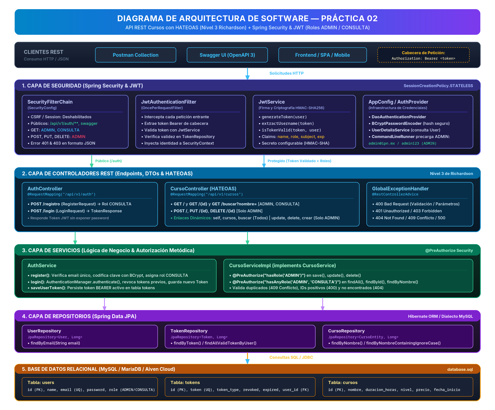
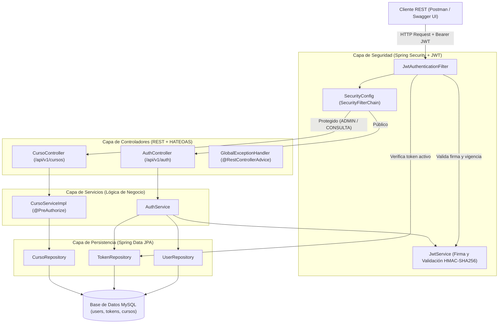

# Práctica 02 — API REST de Cursos (Nivel 3 de Richardson con HATEOAS + JWT)

API RESTful desarrollada con **Spring Boot**, **Spring HATEOAS**, **Spring Security**, **JSON Web Token (JWT)** y **Spring Data JPA (MySQL)** para la administración de cursos, alcanzando el **Nivel 3 del Modelo de Madurez de Richardson** y aplicando autenticación y autorización basada en roles (`ADMIN` y `CONSULTA`).

---

## 1. Diagrama de Arquitectura



> **Archivos del diagrama visual:**
> - [Imagen PNG de alta resolución (2700x2240)](./docs/arquitectura.png)
> - [Vectorial SVG escalable](./docs/arquitectura.svg)
> - [Detalle por capas y matriz de hipermedios](./docs/ARQUITECTURA.md)

### Vista Conceptual de Flujo:


---

## 2. Usuarios y Roles

El sistema implementa dos roles:
- **`ADMIN`**: Puede consultar, buscar, registrar, actualizar y eliminar cursos.
  - **Usuario pre-cargado automáticamente al iniciar la aplicación (`AppConfig`):**
    - **Email:** `admin@ipn.mx`
    - **Contraseña:** `admin123`
- **`CONSULTA`**: Puede consultar el listado de cursos, consultar por ID y buscar por nombre, pero **no puede** crear, actualizar ni eliminar cursos.
  - Todo usuario registrado mediante `POST /api/v1/auth/registro` recibe automáticamente el rol **`CONSULTA`**.

---

## 3. Documentación de Endpoints

### 3.1. Autenticación (`/api/v1/auth`)

| Método | Ruta | Acceso | Descripción |
| :--- | :--- | :--- | :--- |
| `POST` | `/api/v1/auth/registro` | Público | Registra un usuario nuevo con rol `CONSULTA` y devuelve su `access_token` JWT. |
| `POST` | `/api/v1/auth/login` | Público | Autentica credenciales (`email`, `password`) y devuelve un `access_token` JWT firmado. |

**Ejemplo Solicitud Registro (`POST /api/v1/auth/registro`):**
```json
{
  "email": "consulta@ipn.mx",
  "password": "consulta123",
  "name": "Juan Pérez"
}
```

**Ejemplo Solicitud Login (`POST /api/v1/auth/login`):**
```json
{
  "email": "admin@ipn.mx",
  "password": "admin123"
}
```

**Respuesta Exitosa (`200 OK` / `201 Created`):**
```json
{
  "access_token": "eyJhbGciOiJIUzM4NCJ9..."
}
```

---

### 3.2. Recursos: Cursos (`/api/v1/cursos`)

Todos los endpoints de `/api/v1/cursos` requieren enviar la cabecera:
```http
Authorization: Bearer <access_token>
```

| Método | Ruta | Roles Permitidos | Función | Código Éxito |
| :--- | :--- | :--- | :--- | :--- |
| `GET` | `/api/v1/cursos` | `ADMIN`, `CONSULTA` | Consultar el listado de todos los cursos con enlaces HATEOAS. | `200 OK` |
| `GET` | `/api/v1/cursos/{id}` | `ADMIN`, `CONSULTA` | Consultar un curso específico por ID con enlaces HATEOAS. | `200 OK` |
| `GET` | `/api/v1/cursos/buscar?nombre=...` | `ADMIN`, `CONSULTA` | Buscar cursos cuyo nombre coincida con el parámetro. | `200 OK` |
| `POST` | `/api/v1/cursos` | `ADMIN` | Registrar un nuevo curso. | `201 Created` |
| `PUT` | `/api/v1/cursos/{id}` | `ADMIN` | Actualizar un curso existente. | `200 OK` |
| `DELETE` | `/api/v1/cursos/{id}` | `ADMIN` | Eliminar un curso por ID. | `200 OK` |

**Ejemplo Cuerpo Crear/Actualizar Curso (`POST` / `PUT`):**
```json
{
  "nombre": "Java con Spring Boot",
  "duracionHoras": 40,
  "nivel": "medio",
  "precio": 1499.90,
  "fechaInicio": "2026-11-02"
}
```

**Ejemplo Respuesta Individual con HATEOAS (`GET /api/v1/cursos/1`):**
```json
{
  "estado": 200,
  "mensaje": "Curso encontrado",
  "datos": {
    "id": 1,
    "nombre": "Java con Spring Boot",
    "duracionHoras": 40,
    "nivel": "medio",
    "precio": 1499.90,
    "fechaInicio": "2026-11-02",
    "links": [
      {
        "rel": "self",
        "href": "http://localhost:8080/api/v1/cursos/1"
      },
      {
        "rel": "update",
        "href": "http://localhost:8080/api/v1/cursos/1"
      },
      {
        "rel": "delete",
        "href": "http://localhost:8080/api/v1/cursos/1"
      },
      {
        "rel": "cursos",
        "href": "http://localhost:8080/api/v1/cursos"
      },
      {
        "rel": "buscar",
        "href": "http://localhost:8080/api/v1/cursos/buscar?nombre=Java%20con%20Spring%20Boot"
      }
    ]
  }
}
```

---

## 4. Entregables Incluidos en el Repositorio

1. **Código fuente organizado por capas**: `auth`, `usuario`, `cursos`, `config`, `common`.
2. **Script de base de datos**: [`database.sql`](./database.sql).
3. **Colección de Postman**: [`Practica02_Postman_Collection.json`](./Practica02_Postman_Collection.json) con las 12 pruebas obligatorias automatizadas.
4. **Despliegue en Render y Swagger UI**: [`Dockerfile`](./Dockerfile) configurado con JDK 25 y Swagger UI accesible en `/swagger-ui/index.html` con soporte para **Authorize (Bearer JWT)**.
