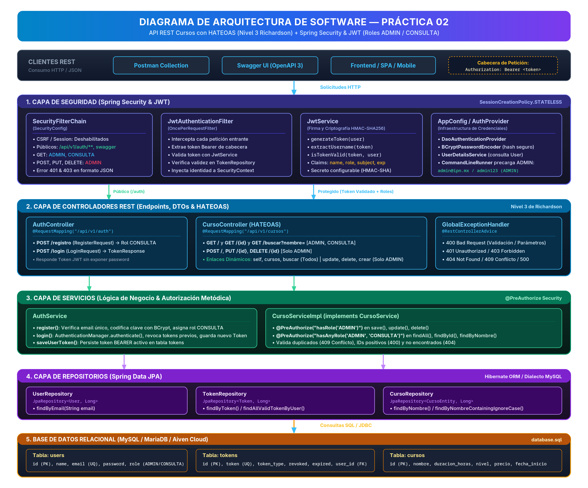

# Diagrama de Arquitectura — Práctica 02

API REST de Cursos (Nivel 3 de Richardson con HATEOAS) protegida con Spring Security y JWT.

La aplicación está organizada en capas: **controladores**, **servicios**, **repositorios** y **componentes de seguridad**, sobre una base de datos MySQL.

---

## 1. Diagrama Visual de Arquitectura

A continuación se muestra el diagrama visual de la arquitectura del sistema:

> **Archivos gráficos disponibles en esta carpeta:**
> - [Imagen PNG de alta resolución (2700x2240)](./arquitectura.png)
> - [Vectorial SVG escalable](./arquitectura.svg)

---

## 2. Descripción de Componentes por Capas

| Capa | Componente | Archivo | Responsabilidad |
| :--- | :--- | :--- | :--- |
| **Seguridad** | `SecurityConfig` | `config/SecurityConfig.java` | Define el `SecurityFilterChain`: sesión STATELESS, rutas públicas (`/auth/**`, Swagger), reglas por rol y respuestas JSON 401/403 estandarizadas. |
| **Seguridad** | `JwtAuthenticationFilter` | `config/JwtAuthenticationFilter.java` | Intercepta cada petición, extrae el token Bearer, valida su firma con `JwtService`, consulta su estado en `TokenRepository` y establece la identidad en `SecurityContextHolder`. |
| **Seguridad** | `JwtService` | `auth/service/JwtService.java` | Genera el JWT firmado con HMAC-SHA256 (claims: sub, name, role, exp) y valida su integridad y fecha de vigencia. |
| **Seguridad** | `AppConfig` | `config/AppConfig.java` | Proveedor `DaoAuthenticationProvider`, `BCryptPasswordEncoder`, `UserDetailsService` y bean `CommandLineRunner` que pre-carga al usuario ADMIN (`admin@ipn.mx` / `admin123`). |
| **Controlador** | `AuthController` | `auth/controller/AuthController.java` | Endpoints públicos `/api/v1/auth/registro` (asigna rol `CONSULTA`) y `/api/v1/auth/login` (emite token de acceso). |
| **Controlador** | `CursoController` | `cursos/CursoController.java` | Operaciones CRUD y búsqueda `/api/v1/cursos`. Incorpora hipervínculos HATEOAS (`self`, `cursos`, `buscar`, `update`, `delete`, `crear`) condicionados según el rol del usuario autenticado. |
| **Controlador** | `GlobalExceptionHandler` | `common/GlobalExceptionHandler.java` | Capturador global de errores (`@RestControllerAdvice`). Retorna respuestas estándar `{ estado, mensaje, datos }` para 400, 401, 403, 404, 409 y 500. |
| **Servicio** | `AuthService` | `auth/service/AuthService.java` | Lógica de autenticación, verificación de email único, hash con BCrypt, emisión de JWT y revocación/guardado en tabla `tokens`. |
| **Servicio** | `CursoServiceImpl` | `cursos/CursoServiceImpl.java` | Implementa `CursoService`. Aplica seguridad declarativa con `@PreAuthorize("hasRole('ADMIN')")` para escritura y `@PreAuthorize("hasAnyRole('ADMIN', 'CONSULTA')")` para lectura. Valida duplicados y existencia. |
| **Repositorio** | `UserRepository` | `usuario/UserRepository.java` | Interfaz Spring Data JPA (`JpaRepository<User, Long>`) para consultar usuarios por email. |
| **Repositorio** | `TokenRepository` | `auth/repository/TokenRepository.java` | Interfaz Spring Data JPA (`JpaRepository<Token, Long>`) para consultar tokens activos y revocar anteriores. |
| **Repositorio** | `CursoRepository` | `cursos/CursoRepository.java` | Interfaz Spring Data JPA (`JpaRepository<CursoEntity, Long>`) para operaciones CRUD y búsqueda por nombre ignorando mayúsculas/minúsculas. |
| **Base de Datos**| MySQL / MariaDB | `database.sql` | Tablas relacionales: `users`, `tokens` y `cursos`. |

---

## 3. Matriz de Hipermedios (HATEOAS) según el Rol

| Tipo de Respuesta | Relación (`rel`) | Rol ADMIN | Rol CONSULTA | Significado |
| :--- | :--- | :---: | :---: | :--- |
| **Curso Individual** | `self` | ✅ | ✅ | Enlace al recurso individual (`/api/v1/cursos/{id}`) |
| **Curso Individual** | `cursos` | ✅ | ✅ | Enlace de retorno a la colección general (`/api/v1/cursos`) |
| **Curso Individual** | `buscar` | ✅ | ✅ | Enlace directo para consultar por nombre (`/api/v1/cursos/buscar?nombre=...`) |
| **Curso Individual** | `update` | ✅ | ❌ | Acción de modificación permitida únicamente para administradores |
| **Curso Individual** | `delete` | ✅ | ❌ | Acción de borrado permitida únicamente para administradores |
| **Colección General**| `self` | ✅ | ✅ | Enlace a la colección (`/api/v1/cursos`) |
| **Colección General**| `buscar` | ✅ | ✅ | Enlace a la búsqueda (`/api/v1/cursos/buscar?nombre=`) |
| **Colección General**| `crear` | ✅ | ❌ | Acción de registro anunciada únicamente al rol administrador |

